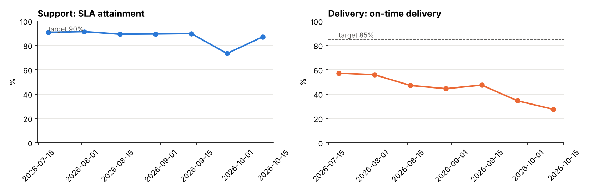

# KPI Reporting Automation (Python + SQL + Excel)

Turns a manual biweekly performance report into a single command. Three messy operational sources (a ticketing export, an Excel delivery tracker kept by hand and a timesheet extract) are consolidated, validated, and turned into a formatted Excel workbook with RAG status, period-over-period change, trend charts, and a KPI dictionary that defines every number.

```bash
python build_report.py            # → reports/kpi_report_2026-10-11.xlsx in seconds
```



## The problem it solves

| Manual process | Automated |
|---|---|
| Copy-paste from 3 systems, each with its own team names, date formats and layouts | Each source read in its native shape and standardised in code |
| KPI definitions live in someone's head, so numbers differ between reports | **`config/kpis.yml`** holds every KPI's SQL, target, direction and plain-English definition |
| Errors found after the report has gone out | **7 data checks run first**, and the report is not produced if any fail (exit code 1) |
| Charts rebuilt by hand each period | Native Excel line charts plus a PNG for slides |

## Report for Sep 28 – Oct 11, 2026

**Support**

| KPI | This period | Last period | Target | Status |
|---|---|---|---|---|
| Tickets resolved | 432 | 405 | — | — |
| SLA attainment | 87.0% | 73.3% | 90.0% | 🟡 Amber |
| Median resolution time (hours) | 17.3 | 29.7 | 24.0 | 🟢 Green |
| First-contact resolution | 68.8% | 65.4% | 70.0% | 🟡 Amber |
| Open backlog at period end | 92 | 97 | — | — |
| Utilisation | 78.6% | 79.8% | 78.0% | 🟢 Green |

**Delivery**

| KPI | This period | Last period | Target | Status |
|---|---|---|---|---|
| On-time delivery | 27.5% | 34.5% | 85.0% | 🔴 Red |
| Tasks completed | 40 | 29 | — | — |
| Average days late (late tasks) | 2.8 | 2.7 | 2.0 | 🟡 Amber |
| Rework rate | 12.5% | 10.3% | 8.0% | 🔴 Red |
| Utilisation | 79.1% | 78.9% | 78.0% | 🟢 Green |

### What the report tells a manager

- **Support recovered from a staffing dip.** SLA attainment fell to 73.3% in the Sep 14–27 period and is back to 87.0%, still short of the 90% target.
- **The backlog is the leading indicator to watch.** It has grown every period, from 20 open tickets in mid-July to 92 now. SLA has recovered, but the queue has not.
- **Delivery is the real problem.** On-time delivery has fallen from 57% in July to 27.5%, while rework rose to 12.5%. Utilisation is on target (79%), so the cause is not idle capacity. It points to estimation or scope, which is worth a conversation with the delivery lead.

## The workbook

| Sheet | Contents |
|---|---|
| **Summary** | Both teams' KPIs with this/last period, ▲▼ change (labelled *good* or *worse* according to each KPI's direction), target and a colour-coded RAG cell. Prints on one landscape page. |
| **Trends** | 7 periods of every KPI, with 4 native Excel line charts |
| **KPI dictionary** | Definition, target, direction and the exact SQL for every KPI |
| **Data checks** | The 7 validation results |

## How it works

1. **Load and standardise** ([`kpi/pipeline.py`](kpi/pipeline.py)). Tickets come as CSV with `YYYY-MM-DD HH:MM` timestamps. The delivery tracker is an `.xlsx` with a title block above the table, so the header row is found automatically, and its dates are `MM/DD/YYYY`. Timesheets are CSV with `DD-Mon-YYYY` dates. Team names (`CS`, `Customer Support`, `delivery`, `Delivery Team`) map to two standard teams.
2. **Validate**: unique IDs, every ticket has an SLA priority, nothing closed before it opened, every team name mapped, billable ≤ logged hours, due ≥ start.
3. **Compute**: each KPI's SQL runs in DuckDB for the current and previous period. RAG status comes from the target and amber band in the config.
4. **Write** ([`kpi/excel_report.py`](kpi/excel_report.py)): openpyxl workbook, Markdown summary and trend PNG.

Adding a KPI means adding one YAML block. No Python changes are needed:

```yaml
- id: rework_rate
  team: Delivery
  name: Rework rate
  definition: Share of tasks completed in the period that were flagged as rework.
  sql: "select avg(case when rework then 1.0 else 0 end) from tasks where completed between :start and :end"
  format: pct
  target: 0.08
  amber_band: 0.03
  direction: lower_is_better
```

## Run it

```bash
pip install -r requirements.txt
python data/generate.py                          # create the three raw sources
python build_report.py                           # latest period (ends 2026-10-11)
python build_report.py --period-end 2026-09-27   # any earlier period
pytest                                           # 5 tests
```

To schedule it, run `build_report.py` from cron or Windows Task Scheduler every other Monday. A non-zero exit code means a data check failed and nothing was sent.

## Data

All data is **synthetic** and seeded: 3,352 support tickets, 240 delivery tasks and 1,070 timesheet rows over 16 weeks from July 6, 2026. It includes a deliberate staffing dip in September and a gradual decline in delivery performance so the report has a story to tell.

## Project structure

```
├── config/kpis.yml        KPI dictionary: SQL, targets, directions, definitions, team aliases
├── kpi/
│   ├── pipeline.py        load, standardise, validate, compute, RAG, trend
│   └── excel_report.py    formatted workbook with native charts
├── data/generate.py       the three messy source extracts
├── build_report.py        one-command entry point
├── reports/               generated workbook + Markdown summary
└── tests/
```

## Tools

Python · SQL (DuckDB) · pandas · openpyxl (Excel) · matplotlib · YAML · pytest
